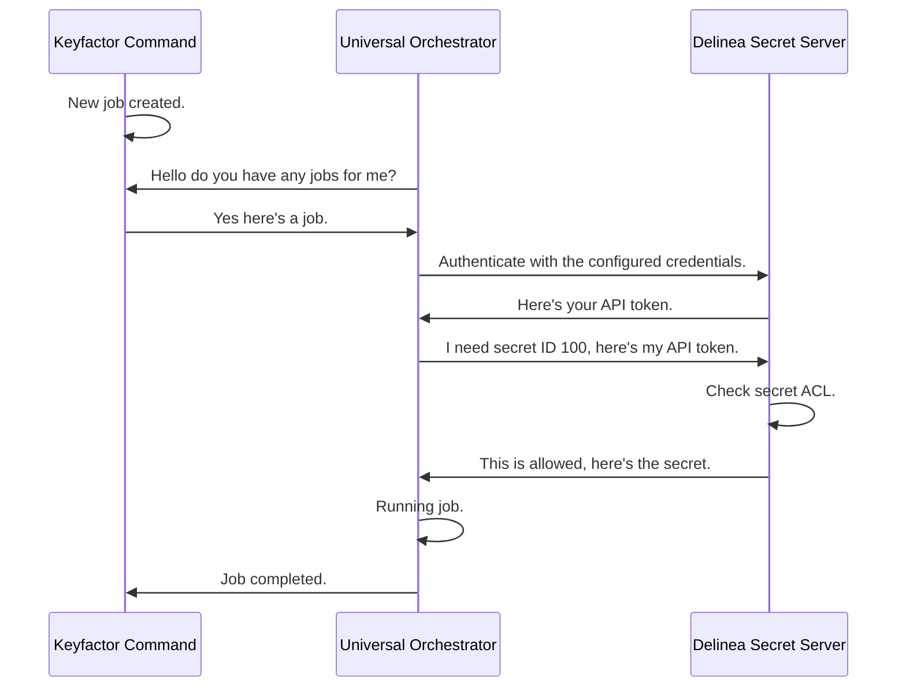
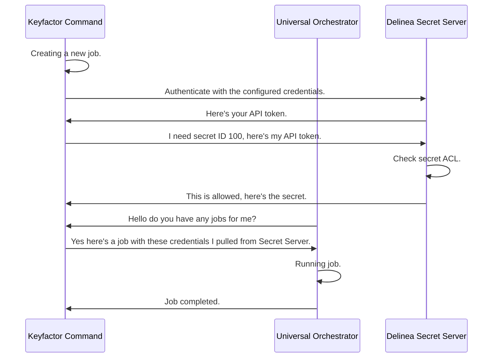

<h1 align="center" style="border-bottom: none">
    Delinea Secret Server PAM Provider
</h1>

<p align="center">
  <!-- Badges -->

<a href="https://github.com/Keyfactor/delinea-secretserver-pam/releases"></a>


</p>

<p align="center">
  <!-- TOC -->
  <a href="#overview">
    <b>Overview</b>
  </a>
  ·
  <a href="#installation">
    <b>Installation</b>
  </a>
  ·
  <a href="#usage">
    <b>Usage</b>
  </a>
  ·
  <a href="#support">
    <b>Support</b>
  </a>
  ·
  <a href="#license">
    <b>License</b>
  </a>
  ·
  <a href="https://github.com/orgs/Keyfactor/repositories?q=pam">
    <b>Related Integrations</b>
  </a>
</p>

## Overview

The Delinea Secret Server PAM Provider allows for the retrieval of stored account credentials from a Delinea Secret
Server secret. Three authentication methods are supported: `password` (username/password), `client_credentials`
(OAuth2 application account), and `windows` (Integrated Windows Authentication).

Terminology used in this document:

* **PAM provider** is this extension (the assemblies installed on the Keyfactor Command host or the Universal Orchestrator).
* **PAM type** is the definition created in Keyfactor Command that declares which parameters the provider takes.
* **Provider instance** is a PAM provider you define in Keyfactor Command from a PAM type, with a name and the server-level values.

## Extension Mechanics

When configuring the Delinea Secret Server for use as a PAM Provider with Keyfactor, you will need to ensure that your
instance is configured for API access. This can be done by logging into the Delinea Secret Server as an administrator.
For more details visit the vendor docs [here](https://docs.delinea.com/online-help/secret-server/api-scripting/sdk-devops/using-sdk/index.htm#SetupProcedure).

Once API access is configured, an account with credentials for the chosen grant type is required (username and password,
client ID and client secret, or the Windows identity of the running process). That account *MUST* be granted access
to view the secrets you'll be using.

After adding and sharing a secret in Secret Server, you can use the secret's ID (the "Secret ID") and the desired value's
field name (the "Secret Field Name") to retrieve credentials from the Delinea Secret Server as a PAM Provider.

For the `password` and `client_credentials` grant types, the provider first requests an access token from the Secret
Server `/oauth2/token` endpoint, then uses that token to read the secret. For `client_credentials`, the token request
is still sent with `grant_type=password`: the Client ID is sent as `username` and the Client Secret as `password`.
For the `windows` grant type there is no token step; the provider calls the Secret Server `winauthwebservices` endpoint
directly using the Windows identity of the running process.

### Running the PAM provider on a Keyfactor Universal Orchestrator (UO)

When installed on a Universal Orchestrator (UO), the PAM provider runs on the UO host. The sequence diagram below
shows the flow when the provider runs from the UO.



### Running the PAM provider on the Keyfactor Command Host

When installed on the Keyfactor Command host, the PAM provider runs on that host. The sequence diagram below shows
the flow when the provider runs from the Keyfactor Command host.



> [!NOTE]
> The authentication and token steps in both diagrams apply to the `password` and `client_credentials` grant types. With
> the `windows` grant type there is no token: the provider calls Secret Server using the Windows identity of the
> running process.

## PAM Types

This provider ships four PAM types. For new installations, use the type-specific variants. They only expose the
fields relevant to the chosen authentication flow, which simplifies configuration in the Keyfactor Command UI.

| PAM Type | Auth Method | Server Parameters |
| --- | --- | --- |
| `Delinea-SecretServer-Password` | Username + Password | `Host`, `Username`, `Password` |
| `Delinea-SecretServer-ClientCredentials` | OAuth2 Client Credentials | `Host`, `ClientId`, `ClientSecret` |
| `Delinea-SecretServer-Windows` | Integrated Windows Authentication | `Host` |
| `Delinea-SecretServer` | Any (selected via `GrantType`) | `Host`, plus credentials for the chosen grant type, `GrantType` (optional) |

> [!NOTE]
> `Delinea-SecretServer` is the original backwards-compatible type retained for existing installations. It exposes all
> credential fields in the Keyfactor Command UI regardless of which grant type is active. `GrantType` is optional and
> defaults to `password` when it is not supplied. Existing installations do not need to change.

> [!IMPORTANT]
> `Delinea-SecretServer-Windows` uses Integrated Windows Authentication, which is not supported on Delinea Secret
> Server Cloud. It is only compatible with on-premises Secret Server installations.

## Configuration Notes

* **`SecretFieldName`** is matched against each field's name or slug on the secret. The comparison is case-sensitive
  and must be exact. An empty value is an error, and so is a field that does not exist on the secret.
* **`GrantType`** (generic `Delinea-SecretServer` type only) is case-sensitive and must be exactly `password`,
  `client_credentials` or `windows`. The shipped placeholder `password|client_credentials|windows` must be replaced
  with one of these values.
* **Dummy values.** The `N/A` convention for unused fields applies to the generic `Delinea-SecretServer` type; see its
  [Requirements](docs/delinea-secretserver.md#requirements).

## Registration and Naming

> [!IMPORTANT]
> A Universal Orchestrator supports only **one** PAM provider registration per `manifest.json` (until UO v26.4).
> Using more than one Delinea PAM type requires a separate Universal Orchestrator for each.

The release contains one manifest file per PAM type. `manifest.json` registers the generic `Delinea-SecretServer`
provider. To use a type-specific provider, replace `manifest.json` with that type's manifest file (rename it to
`manifest.json` on install) and edit it.

| PAM Type / Name | Manifest shipped in the release | Class (`TypeFullName` / `web.config` `mapTo`) |
| --- | --- | --- |
| `Delinea-SecretServer` | `manifest.json` (default) | `Keyfactor.Extensions.Pam.Delinea.SecretServerPam` |
| `Delinea-SecretServer-Password` | `Password-manifest.json` | `Keyfactor.Extensions.Pam.Delinea.SecretServerPamPassword` |
| `Delinea-SecretServer-ClientCredentials` | `ClientCredentials-manifest.json` | `Keyfactor.Extensions.Pam.Delinea.SecretServerPamClientCredentials` |
| `Delinea-SecretServer-Windows` | `Windows-manifest.json` | `Keyfactor.Extensions.Pam.Delinea.SecretServerPamWindows` |

Each manifest registers its extension under the name of the **PAM provider you created in Keyfactor Command** (the
provider instance name, not the PAM type name). The extension entry key is that name itself, with no `PAMProviders.`
prefix and no `.PAMProvider` suffix, and the `InitializationInfo` section is named
`Keyfactor:PAMProviders:<provider name>:InitializationInfo`. The shipped placeholder is `YOUR-PROVIDER-NAME`; replace
it in both places before use. Each manifest contains only this one section. An unedited manifest does not register a
usable provider.

The type-specific classes use a fixed grant type (`password`, `client_credentials`, `windows`), so no `GrantType`
value is required for them. For Command-hosted (Command 10) `web.config` registrations, use the class above with the
assembly name `delinea-secretserver-pam`, for example:
`mapTo="Keyfactor.Extensions.Pam.Delinea.SecretServerPamClientCredentials, delinea-secretserver-pam"`.

> [!NOTE]
> Each PAM type defines exact `manifest.json` and `web.config` snippets for that type,
> and the manifest files are shipped in the release.

> [!WARNING]
> **Upgrading from 1.3.0:** the shipped manifests changed key shape (see the
> changelog). Installing 1.3.1 over an edited `manifest.json` overwrites your edits, and an unedited 1.3.1 manifest
> is not usable until `YOUR-PROVIDER-NAME` is replaced with your PAM provider name. If you use a type-specific
> provider, install its manifest file as `manifest.json`, and remove any `GrantType` workaround you added.

## Installing on a Universal Orchestrator

> [!NOTE]
> Before installing on a Universal Orchestrator, the PAM type and a provider instance must already exist in Keyfactor
> Command. See *Create PAM type in Keyfactor Command* and *Define a remote PAM provider in Command* in the sections for your PAM type below.

These steps apply to every PAM type; each type's install section below only adds the manifest file to use and its
`InitializationInfo` values.

### Step 1: Install the assemblies

* **Using kfutil**: On the server that hosts the Universal Orchestrator, run the following command:

    ```shell
    # Windows Server
    kfutil orchestrator extension -e delinea-secretserver-pam@latest --out "C:\Program Files\Keyfactor\Keyfactor Orchestrator\extensions"

    # Linux
    kfutil orchestrator extension -e delinea-secretserver-pam@latest --out "/opt/keyfactor/orchestrator/extensions"
    ```

* **Manually**: Download the latest release of the Delinea Secret Server PAM Provider from the [Releases](../../releases) page. Extract the contents of the archive to:

    * **Windows Server**: `C:\Program Files\Keyfactor\Keyfactor Orchestrator\extensions\delinea-secretserver-pam`
    * **Linux**: `/opt/keyfactor/orchestrator/extensions/delinea-secretserver-pam`

### Step 2: Select the manifest for your PAM type

Use the manifest file for your PAM type from the table in [Registration and Naming](#registration-and-naming). Only
`Delinea-SecretServer` uses `manifest.json` as shipped; for the type-specific types, replace the contents of
`manifest.json` with the contents of that type's manifest file (for example, delete `manifest.json` and rename
`Password-manifest.json` to `manifest.json`).

### Step 3: Edit `manifest.json`

* Replace `YOUR-PROVIDER-NAME` (the extension entry key and the `InitializationInfo` section name) with the name of the PAM provider you created in Keyfactor Command for your PAM type, that is, the name you gave the provider instance, not the PAM type name. For example, for a provider named `Delinea`, the `extensions` entry key is `"Delinea": { ... }` and the section is `"Keyfactor:PAMProviders:Delinea:InitializationInfo": { ... }`.
* Replace the placeholder values in the section with the values collected in the Requirements section of your PAM type's page:
  [`Delinea-SecretServer`](docs/delinea-secretserver.md#requirements),
  [`Delinea-SecretServer-Password`](docs/delinea-secretserver-password.md#requirements),
  [`Delinea-SecretServer-ClientCredentials`](docs/delinea-secretserver-clientcredentials.md#requirements), or
  [`Delinea-SecretServer-Windows`](docs/delinea-secretserver-windows.md#requirements).
* Do not leave any other `Keyfactor:PAMProviders:*:InitializationInfo` sections in `manifest.json` (for example, sections left over from the 1.3.0 manifest). In testing, sample sections left in `manifest.json` supplied their placeholder values to the plugin in place of the real ones.

> [!IMPORTANT]
> Replace the placeholder `YOUR-PROVIDER-NAME`. It must match the name of the provider instance defined in
> Keyfactor Command. If it does not, the provider may fail to load, with errors such as `No extension configuration found
> for 'Keyfactor.Platform.Extensions.IPAMProvider' with name '<provider name>'` followed by `No PAM provider registered
> with name <provider name>`.

### Step 4: Restart

Restart the Universal Orchestrator service after editing `manifest.json`.

## Troubleshooting

* **Provider not found / not registered on a UO.** Confirm that the `extensions` entry key and the
  `InitializationInfo` section name in `manifest.json` both equal the name of the provider instance in Keyfactor
  Command (not `YOUR-PROVIDER-NAME`), that only one provider is registered in the file, and that the UO service was
  restarted.
* **`Invalid grant type ... specified`.** `GrantType` must be exactly `password`, `client_credentials` or `windows`
  (case-sensitive).
* **`... not provided`.** A required server or instance parameter is missing or empty. Parameters whose value is `N/A`
  are treated as empty.
* **`Unable to parse '<value>' as an integer`.** `SecretId` must be the numeric Secret ID, not the secret's name.
* **`Field '<name>' not found in secret <id>`.** `SecretFieldName` must equal a field name or slug on the secret
  (case-sensitive).
* **Authentication failure.** Check the credentials for the chosen grant type and that the account can view the secret.
  The provider logs the failing step, HTTP status code and the target URL.
* **TLS errors.** Install the Secret Server CA certificate on the host. As a temporary measure in non-production
  environments only, see TLS validation under [Configuration Notes](#configuration-notes).

## Security Considerations

* The values in `manifest.json` `InitializationInfo` (for example `Password`, `ClientSecret`) are stored in plaintext on
  the Universal Orchestrator host. Restrict file-system permissions on the `manifest.json` file to the account that runs
  the orchestrator service and to administrators.
* Grant the Secret Server account used by the provider access only to the secrets it needs.

## Upgrade Notes

See the [CHANGELOG](CHANGELOG.md) for the full release history. In particular, the v1.3.1 sections *Breaking Changes*
and *Upgrade Notes* describe the new `manifest.json` key shape, why an unedited manifest is not usable, and that
installing over an edited `manifest.json` overwrites it.

## Getting Started

The Delinea Secret Server PAM Provider is used by Command to resolve PAM-eligible credentials for Universal Orchestrator extensions and for accessing Certificate Authorities. When configured, Command will use the Delinea Secret Server PAM Provider to retrieve credentials needed to communicate with the target system. There are two ways to install the Delinea Secret Server PAM Provider, and you may elect to use one or both methods:

1. **Locally on the Keyfactor Command server**: PAM credential resolution via the Delinea Secret Server PAM Provider will occur on the Keyfactor Command server each time an eligible credential is needed.
2. **Remotely on Universal Orchestrators**: When Jobs are dispatched to Universal Orchestrators, the associated Certificate Store extension assembly will use the Delinea Secret Server PAM Provider to resolve eligible PAM credentials.

Before proceeding with installation, you should consider which pattern is best for your requirements and use case.

### Installation

> [!IMPORTANT]
> For the most up-to-date and complete documentation on how to install a PAM provider extension, please visit our [product documentation](https://software.keyfactor.com/Core-OnPrem/Current/Content/ReferenceGuide/Preparing%20Third%20Party%20PAM%20Providers%20to%20Work%20with.htm?Highlight=pam%20provider#InstallingCustomPAMProviderExtensions).

To install Delinea Secret Server PAM Provider, it is recommended you install [kfutil](https://github.com/Keyfactor/kfutil). `kfutil` is a command-line tool that simplifies the process of creating PAM Types in Keyfactor Command.

The Delinea Secret Server PAM Provider implements four PAM Types. Depending on your use case, you may elect to install one, or all of these PAM Types. An overview for each type is linked below:

* [Delinea-SecretServer](docs/delinea-secretserver.md)
* [Delinea-SecretServer-Password](docs/delinea-secretserver-password.md)
* [Delinea-SecretServer-ClientCredentials](docs/delinea-secretserver-clientcredentials.md)
* [Delinea-SecretServer-Windows](docs/delinea-secretserver-windows.md)

<details><summary>Delinea-SecretServer</summary>

#### Overview

`Delinea-SecretServer` is the original backwards-compatible PAM type. It supports all three authentication methods
(`password`, `client_credentials`, `windows`) selected at runtime via the `GrantType` configuration parameter.
The Keyfactor Command UI will display every credential field regardless of which grant type is active.

For new installations, use the type-specific variants (`Delinea-SecretServer-Password`,
`Delinea-SecretServer-ClientCredentials`, or `Delinea-SecretServer-Windows`) which only show the fields relevant
to the chosen authentication method.

#### Requirements

   - Delinea Secret Server instance accessible over HTTPS from the host running Keyfactor Command or the Universal Orchestrator.
   - A service account or application account with permission to view the secrets being retrieved. See the
     [Delinea Secret Server documentation](https://docs.delinea.com/online-help/secret-server/api-scripting/authentication/script-token-auth/index.htm)
     for information on configuring service accounts and application accounts.
   - `GrantType` is optional and defaults to `password` when omitted. It is case-sensitive and must be exactly `password`, `client_credentials` or `windows`; the shipped `manifest.json` placeholder `password|client_credentials|windows` must be replaced with one of these.
   - The `SecretFieldName` value must match a field's name or slug on the secret exactly (the comparison is case-sensitive). An empty value, or a field that does not exist on the secret, is an error.

   **Dummy values (`N/A`).** The Keyfactor Command UI requires all declared fields of this type to be populated. For
   fields that do not apply to the chosen authentication flow, enter `N/A` as the value. The provider treats `N/A`
   (case-insensitive) as an empty value and does not use it. The type-specific PAM types avoid this because they only
   expose the fields relevant to their authentication flow.

#### Create PAM type in Keyfactor Command

##### Using `kfutil`

Create the required PAM Types in the connected Command platform.

```shell
# Delinea-SecretServer
kfutil pam-types create -r delinea-secretserver-pam -n Delinea-SecretServer
```

##### Using the API

For full API docs please visit our [product documentation](https://software.keyfactor.com/Core-OnPrem/Current/Content/WebAPI/KeyfactorAPI/PAMProvidersPOSTTypes.htm?Highlight=pam%20type).

Below is the payload to `POST` to the Keyfactor Command API:

```json
{
  "Name": "Delinea-SecretServer",
  "Parameters": [
    {
      "Name": "Host",
      "DisplayName": "Secret Server URL",
      "Description": "The URL to the Secret Server instance. Example: https://example.secretservercloud.com/SecretServer",
      "DataType": 1,
      "InstanceLevel": false
    },
    {
      "Name": "Username",
      "DisplayName": "Secret Server Username",
      "Description": "The username used to authenticate to the Secret Server instance. NOTE: only applicable if using the `password` grant type.",
      "DataType": 1,
      "InstanceLevel": false
    },
    {
      "Name": "Password",
      "DisplayName": "Secret Server Password",
      "Description": "The password used to authenticate to the Secret Server instance. NOTE: only applicable if using the `password` grant type.",
      "DataType": 2,
      "InstanceLevel": false
    },
    {
      "Name": "ClientId",
      "DisplayName": "Secret Server Client ID",
      "Description": "The client ID used to authenticate to the Secret Server instance. NOTE: only applicable if using the `client_credentials` grant type.",
      "DataType": 1,
      "InstanceLevel": false
    },
    {
      "Name": "ClientSecret",
      "DisplayName": "Secret Server Client Secret",
      "Description": "The client secret used to authenticate to the Secret Server instance. NOTE: only applicable if using the `client_credentials` grant type.",
      "DataType": 2,
      "InstanceLevel": false
    },
    {
      "Name": "GrantType",
      "DisplayName": "Grant Type",
      "Description": "The grant type used to authenticate to the Secret Server instance. Valid values are `password`, `client_credentials`, or `windows`. Default is `password`. If not provided the default value `password` will be used to maintain backwards compatibility.",
      "DataType": 1,
      "InstanceLevel": false
    },
    {
      "Name": "SkipTlsValidation",
      "DisplayName": "Skip TLS Validation",
      "Description": "Set to `true` to disable TLS certificate validation. Use only in non-production environments.",
      "DataType": 1,
      "InstanceLevel": false
    },
    {
      "Name": "SecretId",
      "DisplayName": "Secret ID",
      "Description": "The ID of the secret in Secret Server. This is the integer ID that is used to retrieve the secret from Secret Server.",
      "DataType": 1,
      "InstanceLevel": true
    },
    {
      "Name": "SecretFieldName",
      "DisplayName": "Secret Field Name",
      "Description": "The name of the field in the secret that contains the credential value. NOTE: The value must exactly match (case-sensitive) the name or slug of a field on the secret, and must not be empty.",
      "DataType": 1,
      "InstanceLevel": true
    }
  ]
}
```

#### Install PAM provider on Keyfactor Command Host (Local)

1. On the server that hosts Keyfactor Command, download and unzip the latest release of the Delinea Secret Server PAM Provider from the [Releases](../../releases) page.

2. Copy the assemblies to the appropriate directories on the Keyfactor Command server:

    <details><summary>Keyfactor Command 11+</summary>

    1. Copy the unzipped assemblies to each of the following directories:

        * `C:\Program Files\Keyfactor\Keyfactor Platform\WebAgentServices\Extensions\delinea-secretserver-pam`
        * `C:\Program Files\Keyfactor\Keyfactor Platform\WebConsole\Extensions\delinea-secretserver-pam`
        * `C:\Program Files\Keyfactor\Keyfactor Platform\KeyfactorAPI\Extensions\delinea-secretserver-pam`

    </details>

    <details><summary>Keyfactor Command 10</summary>

    1. Copy the assemblies to each of the following directories:

        * `C:\Program Files\Keyfactor\Keyfactor Platform\WebAgentServices\bin\delinea-secretserver-pam`
        * `C:\Program Files\Keyfactor\Keyfactor Platform\KeyfactorAPI\bin\delinea-secretserver-pam`
        * `C:\Program Files\Keyfactor\Keyfactor Platform\WebConsole\bin\delinea-secretserver-pam`
        * `C:\Program Files\Keyfactor\Keyfactor Platform\Service\delinea-secretserver-pam`

    2. Open a text editor on the Keyfactor Command server as an administrator and open the `web.config` file located in the `WebAgentServices` directory.

    3. In the `web.config` file, locate the `<container> </container>` section and add the following registration:

        ```xml
        <container>
            ...
            <!--The following are PAM Provider registrations. Uncomment them to use them in the Keyfactor Product:-->

            <!--Add the following line exactly to register the PAM Provider-->
            <register type="IPAMProvider" mapTo="Keyfactor.Extensions.Pam.Delinea.SecretServerPam, delinea-secretserver-pam" name="Delinea-SecretServer" />
        </container>
        ```

    4. Repeat steps 2 and 3 for each of the directories listed in step 1. The configuration files are located in the following paths by default:

        * `C:\Program Files\Keyfactor\Keyfactor Platform\WebAgentServices\web.config`
        * `C:\Program Files\Keyfactor\Keyfactor Platform\KeyfactorAPI\web.config`
        * `C:\Program Files\Keyfactor\Keyfactor Platform\WebConsole\web.config`
        * `C:\Program Files\Keyfactor\Keyfactor Platform\Service\CMSTimerService.exe.config`

    </details>

3. Restart the Keyfactor Command services (`iisreset`).

#### Install PAM provider on a Universal Orchestrator Host (Remote)

> [!NOTE]
> Before installing, create the PAM type and define a provider instance in Keyfactor Command, as described in the sections above for this PAM type and in [Usage](#usage).

1. Install the Delinea Secret Server PAM Provider assemblies as described in Step 1 of [Installing on a Universal Orchestrator](#installing-on-a-universal-orchestrator).

2. The `Delinea-SecretServer` type uses the `manifest.json` file as shipped; no rename is needed. (The release also contains `Password-manifest.json`, `ClientCredentials-manifest.json` and `Windows-manifest.json` for the other PAM types.) The file contents are shown in [Delinea-SecretServer Registration Snippets](#delinea-secretserver-registration-snippets).

3. Edit `manifest.json` as described in Step 3 of [Installing on a Universal Orchestrator](#installing-on-a-universal-orchestrator): replace `YOUR-PROVIDER-NAME` with the name of your PAM provider in Keyfactor Command and fill in the placeholder values from the [requirements](docs/delinea-secretserver.md#requirements) section.

4. Restart the Universal Orchestrator service after editing `manifest.json`.

</details>

<details><summary>Delinea-SecretServer-Password</summary>

#### Overview

The `Delinea-SecretServer-Password` PAM type authenticates to Delinea Secret Server using a username and password
(OAuth2 `password` grant). This is the recommended type for environments where a service account with a username
and password is used.

#### Requirements

   - Delinea Secret Server instance accessible over HTTPS from the host running Keyfactor Command or the Universal Orchestrator.
   - A service account with a username and password that has permission to view the secrets being retrieved. See the
     [Delinea Secret Server documentation](https://docs.delinea.com/online-help/secret-server/api-scripting/authentication/script-token-auth/index.htm)
     for information on configuring service accounts.
   - The `SecretFieldName` value must match a field's name or slug on the secret exactly (the comparison is case-sensitive). An empty value, or a field that does not exist on the secret, is an error.

#### Create PAM type in Keyfactor Command

##### Using `kfutil`

Create the required PAM Types in the connected Command platform.

```shell
# Delinea-SecretServer-Password
kfutil pam-types create -r delinea-secretserver-pam -n Delinea-SecretServer-Password
```

##### Using the API

For full API docs please visit our [product documentation](https://software.keyfactor.com/Core-OnPrem/Current/Content/WebAPI/KeyfactorAPI/PAMProvidersPOSTTypes.htm?Highlight=pam%20type).

Below is the payload to `POST` to the Keyfactor Command API:

```json
{
  "Name": "Delinea-SecretServer-Password",
  "Parameters": [
    {
      "Name": "Host",
      "DisplayName": "Secret Server URL",
      "Description": "The URL to the Secret Server instance. Example: https://example.secretservercloud.com/SecretServer",
      "DataType": 1,
      "InstanceLevel": false
    },
    {
      "Name": "Username",
      "DisplayName": "Secret Server Username",
      "Description": "The username used to authenticate to the Secret Server instance.",
      "DataType": 1,
      "InstanceLevel": false
    },
    {
      "Name": "Password",
      "DisplayName": "Secret Server Password",
      "Description": "The password used to authenticate to the Secret Server instance.",
      "DataType": 2,
      "InstanceLevel": false
    },
    {
      "Name": "SkipTlsValidation",
      "DisplayName": "Skip TLS Validation",
      "Description": "Set to `true` to disable TLS certificate validation. Use only in non-production environments.",
      "DataType": 1,
      "InstanceLevel": false
    },
    {
      "Name": "SecretId",
      "DisplayName": "Secret ID",
      "Description": "The ID of the secret in Secret Server. This is the integer ID that is used to retrieve the secret from Secret Server.",
      "DataType": 1,
      "InstanceLevel": true
    },
    {
      "Name": "SecretFieldName",
      "DisplayName": "Secret Field Name",
      "Description": "The name of the field in the secret that contains the credential value. NOTE: The value must exactly match (case-sensitive) the name or slug of a field on the secret, and must not be empty.",
      "DataType": 1,
      "InstanceLevel": true
    }
  ]
}
```

#### Install PAM provider on Keyfactor Command Host (Local)

1. On the server that hosts Keyfactor Command, download and unzip the latest release of the Delinea Secret Server PAM Provider from the [Releases](../../releases) page.

2. Copy the assemblies to the appropriate directories on the Keyfactor Command server:

    <details><summary>Keyfactor Command 11+</summary>

    1. Copy the unzipped assemblies to each of the following directories:

        * `C:\Program Files\Keyfactor\Keyfactor Platform\WebAgentServices\Extensions\delinea-secretserver-pam`
        * `C:\Program Files\Keyfactor\Keyfactor Platform\WebConsole\Extensions\delinea-secretserver-pam`
        * `C:\Program Files\Keyfactor\Keyfactor Platform\KeyfactorAPI\Extensions\delinea-secretserver-pam`

    </details>

    <details><summary>Keyfactor Command 10</summary>

    1. Copy the assemblies to each of the following directories:

        * `C:\Program Files\Keyfactor\Keyfactor Platform\WebAgentServices\bin\delinea-secretserver-pam`
        * `C:\Program Files\Keyfactor\Keyfactor Platform\KeyfactorAPI\bin\delinea-secretserver-pam`
        * `C:\Program Files\Keyfactor\Keyfactor Platform\WebConsole\bin\delinea-secretserver-pam`
        * `C:\Program Files\Keyfactor\Keyfactor Platform\Service\delinea-secretserver-pam`

    2. Open a text editor on the Keyfactor Command server as an administrator and open the `web.config` file located in the `WebAgentServices` directory.

    3. In the `web.config` file, locate the `<container> </container>` section and add the following registration:

        ```xml
        <container>
            ...
            <!--The following are PAM Provider registrations. Uncomment them to use them in the Keyfactor Product:-->

            <!--Add the following line exactly to register the PAM Provider-->
            <register type="IPAMProvider" mapTo="Keyfactor.Extensions.Pam.Delinea.SecretServerPamPassword, delinea-secretserver-pam" name="Delinea-SecretServer-Password" />
        </container>
        ```

    4. Repeat steps 2 and 3 for each of the directories listed in step 1. The configuration files are located in the following paths by default:

        * `C:\Program Files\Keyfactor\Keyfactor Platform\WebAgentServices\web.config`
        * `C:\Program Files\Keyfactor\Keyfactor Platform\KeyfactorAPI\web.config`
        * `C:\Program Files\Keyfactor\Keyfactor Platform\WebConsole\web.config`
        * `C:\Program Files\Keyfactor\Keyfactor Platform\Service\CMSTimerService.exe.config`

    </details>

3. Restart the Keyfactor Command services (`iisreset`).

#### Install PAM provider on a Universal Orchestrator Host (Remote)

> [!NOTE]
> Before installing, create the PAM type and define a provider instance in Keyfactor Command, as described in the sections above for this PAM type and in [Usage](#usage).

1. Install the Delinea Secret Server PAM Provider assemblies as described in Step 1 of [Installing on a Universal Orchestrator](#installing-on-a-universal-orchestrator).

2. To use `Delinea-SecretServer-Password`, replace the contents of `manifest.json` with the contents of `Password-manifest.json` (for example, delete `manifest.json` and rename `Password-manifest.json` to `manifest.json`). The file contents are shown in [Delinea-SecretServer-Password Registration Snippets](#delinea-secretserver-password-registration-snippets).

3. Edit `manifest.json` as described in Step 3 of [Installing on a Universal Orchestrator](#installing-on-a-universal-orchestrator): replace `YOUR-PROVIDER-NAME` with the name of your PAM provider in Keyfactor Command and fill in the placeholder values from the [requirements](docs/delinea-secretserver-password.md#requirements) section.

4. Restart the Universal Orchestrator service after editing `manifest.json`.

</details>

<details><summary>Delinea-SecretServer-ClientCredentials</summary>

#### Overview

The `Delinea-SecretServer-ClientCredentials` PAM type authenticates to Delinea Secret Server using an application
account (Client ID and Client Secret). This is the recommended type for service-to-service integrations where an
application account is used instead of a user account.

Secret Server's `/oauth2/token` endpoint is always called with `grant_type=password`. The provider therefore sends the
Client ID as the token request's `username` and the Client Secret as its `password`; this is how Secret Server expects
application accounts to authenticate.

#### Requirements

   - Delinea Secret Server instance accessible over HTTPS from the host running Keyfactor Command or the Universal Orchestrator.
   - An application account (Client ID and Client Secret) with permission to view the secrets being retrieved. See the
     [Delinea Secret Server documentation](https://docs.delinea.com/online-help/secret-server/api-scripting/authentication/script-token-auth/index.htm)
     for information on configuring application accounts.
   - The `SecretFieldName` value must match a field's name or slug on the secret exactly (the comparison is case-sensitive). An empty value, or a field that does not exist on the secret, is an error.

#### Create PAM type in Keyfactor Command

##### Using `kfutil`

Create the required PAM Types in the connected Command platform.

```shell
# Delinea-SecretServer-ClientCredentials
kfutil pam-types create -r delinea-secretserver-pam -n Delinea-SecretServer-ClientCredentials
```

##### Using the API

For full API docs please visit our [product documentation](https://software.keyfactor.com/Core-OnPrem/Current/Content/WebAPI/KeyfactorAPI/PAMProvidersPOSTTypes.htm?Highlight=pam%20type).

Below is the payload to `POST` to the Keyfactor Command API:

```json
{
  "Name": "Delinea-SecretServer-ClientCredentials",
  "Parameters": [
    {
      "Name": "Host",
      "DisplayName": "Secret Server URL",
      "Description": "The URL to the Secret Server instance. Example: https://example.secretservercloud.com/SecretServer",
      "DataType": 1,
      "InstanceLevel": false
    },
    {
      "Name": "ClientId",
      "DisplayName": "OAuth2 Client ID",
      "Description": "The client ID (application account name) used for OAuth2 client credentials authentication.",
      "DataType": 1,
      "InstanceLevel": false
    },
    {
      "Name": "ClientSecret",
      "DisplayName": "OAuth2 Client Secret",
      "Description": "The client secret (application account password) used for OAuth2 client credentials authentication.",
      "DataType": 2,
      "InstanceLevel": false
    },
    {
      "Name": "SkipTlsValidation",
      "DisplayName": "Skip TLS Validation",
      "Description": "Set to `true` to disable TLS certificate validation. Use only in non-production environments.",
      "DataType": 1,
      "InstanceLevel": false
    },
    {
      "Name": "SecretId",
      "DisplayName": "Secret ID",
      "Description": "The ID of the secret in Secret Server. This is the integer ID that is used to retrieve the secret from Secret Server.",
      "DataType": 1,
      "InstanceLevel": true
    },
    {
      "Name": "SecretFieldName",
      "DisplayName": "Secret Field Name",
      "Description": "The name of the field in the secret that contains the credential value. NOTE: The value must exactly match (case-sensitive) the name or slug of a field on the secret, and must not be empty.",
      "DataType": 1,
      "InstanceLevel": true
    }
  ]
}
```

#### Install PAM provider on Keyfactor Command Host (Local)

1. On the server that hosts Keyfactor Command, download and unzip the latest release of the Delinea Secret Server PAM Provider from the [Releases](../../releases) page.

2. Copy the assemblies to the appropriate directories on the Keyfactor Command server:

    <details><summary>Keyfactor Command 11+</summary>

    1. Copy the unzipped assemblies to each of the following directories:

        * `C:\Program Files\Keyfactor\Keyfactor Platform\WebAgentServices\Extensions\delinea-secretserver-pam`
        * `C:\Program Files\Keyfactor\Keyfactor Platform\WebConsole\Extensions\delinea-secretserver-pam`
        * `C:\Program Files\Keyfactor\Keyfactor Platform\KeyfactorAPI\Extensions\delinea-secretserver-pam`

    </details>

    <details><summary>Keyfactor Command 10</summary>

    1. Copy the assemblies to each of the following directories:

        * `C:\Program Files\Keyfactor\Keyfactor Platform\WebAgentServices\bin\delinea-secretserver-pam`
        * `C:\Program Files\Keyfactor\Keyfactor Platform\KeyfactorAPI\bin\delinea-secretserver-pam`
        * `C:\Program Files\Keyfactor\Keyfactor Platform\WebConsole\bin\delinea-secretserver-pam`
        * `C:\Program Files\Keyfactor\Keyfactor Platform\Service\delinea-secretserver-pam`

    2. Open a text editor on the Keyfactor Command server as an administrator and open the `web.config` file located in the `WebAgentServices` directory.

    3. In the `web.config` file, locate the `<container> </container>` section and add the following registration:

        ```xml
        <container>
            ...
            <!--The following are PAM Provider registrations. Uncomment them to use them in the Keyfactor Product:-->

            <!--Add the following line exactly to register the PAM Provider-->
            <register type="IPAMProvider" mapTo="Keyfactor.Extensions.Pam.Delinea.SecretServerPamClientCredentials, delinea-secretserver-pam" name="Delinea-SecretServer-ClientCredentials" />
        </container>
        ```

    4. Repeat steps 2 and 3 for each of the directories listed in step 1. The configuration files are located in the following paths by default:

        * `C:\Program Files\Keyfactor\Keyfactor Platform\WebAgentServices\web.config`
        * `C:\Program Files\Keyfactor\Keyfactor Platform\KeyfactorAPI\web.config`
        * `C:\Program Files\Keyfactor\Keyfactor Platform\WebConsole\web.config`
        * `C:\Program Files\Keyfactor\Keyfactor Platform\Service\CMSTimerService.exe.config`

    </details>

3. Restart the Keyfactor Command services (`iisreset`).

#### Install PAM provider on a Universal Orchestrator Host (Remote)

> [!NOTE]
> Before installing, create the PAM type and define a provider instance in Keyfactor Command, as described in the sections above for this PAM type and in [Usage](#usage).

1. Install the Delinea Secret Server PAM Provider assemblies as described in Step 1 of [Installing on a Universal Orchestrator](#installing-on-a-universal-orchestrator).

2. To use `Delinea-SecretServer-ClientCredentials`, replace the contents of `manifest.json` with the contents of `ClientCredentials-manifest.json` (for example, delete `manifest.json` and rename `ClientCredentials-manifest.json` to `manifest.json`). The file contents are shown in [Delinea-SecretServer-ClientCredentials Registration Snippets](#delinea-secretserver-clientcredentials-registration-snippets).

3. Edit `manifest.json` as described in Step 3 of [Installing on a Universal Orchestrator](#installing-on-a-universal-orchestrator): replace `YOUR-PROVIDER-NAME` with the name of your PAM provider in Keyfactor Command and fill in the placeholder values from the [requirements](docs/delinea-secretserver-clientcredentials.md#requirements) section.

4. Restart the Universal Orchestrator service after editing `manifest.json`.

</details>

<details><summary>Delinea-SecretServer-Windows</summary>

#### Overview

The `Delinea-SecretServer-Windows` PAM type authenticates to Delinea Secret Server using Integrated Windows
Authentication (IWA). No credentials are required in the configuration; the provider uses the Windows identity
of the process running Keyfactor Command or the Universal Orchestrator. No access token is requested; the secret is
retrieved from the `/winauthwebservices/api/v1/secrets/{id}` endpoint.

> [!IMPORTANT]
> Integrated Windows Authentication is not supported on Delinea Secret Server Cloud. This type is only compatible
> with on-premises Secret Server installations.

#### Requirements

   > [!IMPORTANT]
   > Integrated Windows Authentication is not supported on Delinea Secret Server Cloud. This type is only compatible
   > with on-premises Secret Server installations.

   - On-premises Delinea Secret Server instance accessible from the host running Keyfactor Command or the Universal Orchestrator.
   - The Windows service account running Keyfactor Command or the Universal Orchestrator must have permission to view
     the secrets being retrieved. See the
     [Delinea Secret Server IWA documentation](https://docs.delinea.com/online-help/secret-server/authentication/iwa-webservices/webservice-iwa-powershell/index.htm)
     for information on configuring IWA access.
   - The Secret Server instance must be configured to allow Integrated Windows Authentication web service access.
   - The `SecretFieldName` value must match a field's name or slug on the secret exactly (the comparison is case-sensitive). An empty value, or a field that does not exist on the secret, is an error.

#### Create PAM type in Keyfactor Command

##### Using `kfutil`

Create the required PAM Types in the connected Command platform.

```shell
# Delinea-SecretServer-Windows
kfutil pam-types create -r delinea-secretserver-pam -n Delinea-SecretServer-Windows
```

##### Using the API

For full API docs please visit our [product documentation](https://software.keyfactor.com/Core-OnPrem/Current/Content/WebAPI/KeyfactorAPI/PAMProvidersPOSTTypes.htm?Highlight=pam%20type).

Below is the payload to `POST` to the Keyfactor Command API:

```json
{
  "Name": "Delinea-SecretServer-Windows",
  "Parameters": [
    {
      "Name": "Host",
      "DisplayName": "Secret Server URL",
      "Description": "The URL to the Secret Server instance. Example: https://example.secretserver.internal/SecretServer. NOTE: IWA is not supported on Secret Server Cloud.",
      "DataType": 1,
      "InstanceLevel": false
    },
    {
      "Name": "SkipTlsValidation",
      "DisplayName": "Skip TLS Validation",
      "Description": "Set to `true` to disable TLS certificate validation. Use only in non-production environments.",
      "DataType": 1,
      "InstanceLevel": false
    },
    {
      "Name": "SecretId",
      "DisplayName": "Secret ID",
      "Description": "The ID of the secret in Secret Server. This is the integer ID that is used to retrieve the secret from Secret Server.",
      "DataType": 1,
      "InstanceLevel": true
    },
    {
      "Name": "SecretFieldName",
      "DisplayName": "Secret Field Name",
      "Description": "The name of the field in the secret that contains the credential value. NOTE: The value must exactly match (case-sensitive) the name or slug of a field on the secret, and must not be empty.",
      "DataType": 1,
      "InstanceLevel": true
    }
  ]
}
```

#### Install PAM provider on Keyfactor Command Host (Local)

1. On the server that hosts Keyfactor Command, download and unzip the latest release of the Delinea Secret Server PAM Provider from the [Releases](../../releases) page.

2. Copy the assemblies to the appropriate directories on the Keyfactor Command server:

    <details><summary>Keyfactor Command 11+</summary>

    1. Copy the unzipped assemblies to each of the following directories:

        * `C:\Program Files\Keyfactor\Keyfactor Platform\WebAgentServices\Extensions\delinea-secretserver-pam`
        * `C:\Program Files\Keyfactor\Keyfactor Platform\WebConsole\Extensions\delinea-secretserver-pam`
        * `C:\Program Files\Keyfactor\Keyfactor Platform\KeyfactorAPI\Extensions\delinea-secretserver-pam`

    </details>

    <details><summary>Keyfactor Command 10</summary>

    1. Copy the assemblies to each of the following directories:

        * `C:\Program Files\Keyfactor\Keyfactor Platform\WebAgentServices\bin\delinea-secretserver-pam`
        * `C:\Program Files\Keyfactor\Keyfactor Platform\KeyfactorAPI\bin\delinea-secretserver-pam`
        * `C:\Program Files\Keyfactor\Keyfactor Platform\WebConsole\bin\delinea-secretserver-pam`
        * `C:\Program Files\Keyfactor\Keyfactor Platform\Service\delinea-secretserver-pam`

    2. Open a text editor on the Keyfactor Command server as an administrator and open the `web.config` file located in the `WebAgentServices` directory.

    3. In the `web.config` file, locate the `<container> </container>` section and add the following registration:

        ```xml
        <container>
            ...
            <!--The following are PAM Provider registrations. Uncomment them to use them in the Keyfactor Product:-->

            <!--Add the following line exactly to register the PAM Provider-->
            <register type="IPAMProvider" mapTo="Keyfactor.Extensions.Pam.Delinea.SecretServerPamWindows, delinea-secretserver-pam" name="Delinea-SecretServer-Windows" />
        </container>
        ```

    4. Repeat steps 2 and 3 for each of the directories listed in step 1. The configuration files are located in the following paths by default:

        * `C:\Program Files\Keyfactor\Keyfactor Platform\WebAgentServices\web.config`
        * `C:\Program Files\Keyfactor\Keyfactor Platform\KeyfactorAPI\web.config`
        * `C:\Program Files\Keyfactor\Keyfactor Platform\WebConsole\web.config`
        * `C:\Program Files\Keyfactor\Keyfactor Platform\Service\CMSTimerService.exe.config`

    </details>

3. Restart the Keyfactor Command services (`iisreset`).

#### Install PAM provider on a Universal Orchestrator Host (Remote)

> [!NOTE]
> Before installing, create the PAM type and define a provider instance in Keyfactor Command, as described in the sections above for this PAM type and in [Usage](#usage).

1. Install the Delinea Secret Server PAM Provider assemblies as described in Step 1 of [Installing on a Universal Orchestrator](#installing-on-a-universal-orchestrator).

2. To use `Delinea-SecretServer-Windows`, replace the contents of `manifest.json` with the contents of `Windows-manifest.json` (for example, delete `manifest.json` and rename `Windows-manifest.json` to `manifest.json`). The file contents are shown in [Delinea-SecretServer-Windows Registration Snippets](#delinea-secretserver-windows-registration-snippets).

3. Edit `manifest.json` as described in Step 3 of [Installing on a Universal Orchestrator](#installing-on-a-universal-orchestrator): replace `YOUR-PROVIDER-NAME` with the name of your PAM provider in Keyfactor Command and fill in the placeholder values from the [requirements](docs/delinea-secretserver-windows.md#requirements) section.

4. Restart the Universal Orchestrator service after editing `manifest.json`.

</details>

### Usage

#### From Keyfactor Command Host (Local)

##### Define a PAM provider in Command

1. In the Keyfactor Command Portal, hover over the ⚙️  (settings) icon in the top right corner of the screen and select **Privileged Access Management**.

2. Select the **Add** button to create a new PAM provider. Click the dropdown for **Provider Type** and select the PAM type you want to use: **Delinea-SecretServer**, **Delinea-SecretServer-Password**, **Delinea-SecretServer-ClientCredentials**, **Delinea-SecretServer-Windows**.

   > [!IMPORTANT]
   > If you're running Keyfactor Command 11+, make sure `Remote Provider` is unchecked.

3. Populate the fields with the necessary information collected in the requirements section of the PAM type you selected, using the table for that type:

   **Delinea-SecretServer** ([requirements](docs/delinea-secretserver.md#requirements))

   | Initialization parameter | Display Name | Description |
   | --- | --- | --- |
   | Host | Secret Server URL | The URL to the Secret Server instance. Example: https://example.secretservercloud.com/SecretServer |
   | Username | Secret Server Username | The username used to authenticate to the Secret Server instance. NOTE: only applicable if using the `password` grant type. |
   | Password | Secret Server Password | The password used to authenticate to the Secret Server instance. NOTE: only applicable if using the `password` grant type. |
   | ClientId | Secret Server Client ID | The client ID used to authenticate to the Secret Server instance. NOTE: only applicable if using the `client_credentials` grant type. |
   | ClientSecret | Secret Server Client Secret | The client secret used to authenticate to the Secret Server instance. NOTE: only applicable if using the `client_credentials` grant type. |
   | GrantType | Grant Type | The grant type used to authenticate to the Secret Server instance. Valid values are `password`, `client_credentials`, or `windows`. Default is `password`. If not provided the default value `password` will be used to maintain backwards compatibility. |
   | SkipTlsValidation | Skip TLS Validation | Set to `true` to disable TLS certificate validation. Use only in non-production environments. |

   **Delinea-SecretServer-Password** ([requirements](docs/delinea-secretserver-password.md#requirements))

   | Initialization parameter | Display Name | Description |
   | --- | --- | --- |
   | Host | Secret Server URL | The URL to the Secret Server instance. Example: https://example.secretservercloud.com/SecretServer |
   | Username | Secret Server Username | The username used to authenticate to the Secret Server instance. |
   | Password | Secret Server Password | The password used to authenticate to the Secret Server instance. |
   | SkipTlsValidation | Skip TLS Validation | Set to `true` to disable TLS certificate validation. Use only in non-production environments. |

   **Delinea-SecretServer-ClientCredentials** ([requirements](docs/delinea-secretserver-clientcredentials.md#requirements))

   | Initialization parameter | Display Name | Description |
   | --- | --- | --- |
   | Host | Secret Server URL | The URL to the Secret Server instance. Example: https://example.secretservercloud.com/SecretServer |
   | ClientId | OAuth2 Client ID | The client ID (application account name) used for OAuth2 client credentials authentication. |
   | ClientSecret | OAuth2 Client Secret | The client secret (application account password) used for OAuth2 client credentials authentication. |
   | SkipTlsValidation | Skip TLS Validation | Set to `true` to disable TLS certificate validation. Use only in non-production environments. |

   **Delinea-SecretServer-Windows** ([requirements](docs/delinea-secretserver-windows.md#requirements))

   | Initialization parameter | Display Name | Description |
   | --- | --- | --- |
   | Host | Secret Server URL | The URL to the Secret Server instance. Example: https://example.secretserver.internal/SecretServer. NOTE: IWA is not supported on Secret Server Cloud. |
   | SkipTlsValidation | Skip TLS Validation | Set to `true` to disable TLS certificate validation. Use only in non-production environments. |

4. Click **Save**. The PAM provider is now available for use in Keyfactor Command.

##### Using the PAM provider

Now, when defining Certificate Stores (**Locations**->**Certificate Stores**), **Delinea-SecretServer**, **Delinea-SecretServer-Password**, **Delinea-SecretServer-ClientCredentials**, **Delinea-SecretServer-Windows** will be available as a PAM provider option. When defining new Certificate Stores, the secret parameter form will display tabs for **Load From Keyfactor Secrets** or **Load From PAM Provider**.

Select the **Load From PAM Provider** tab, choose the provider you defined from the list of **Providers**, and populate the fields with the necessary information from the table for its PAM type below:

**Delinea-SecretServer** ([requirements](docs/delinea-secretserver.md#requirements)), **Delinea-SecretServer-Password** ([requirements](docs/delinea-secretserver-password.md#requirements)), **Delinea-SecretServer-ClientCredentials** ([requirements](docs/delinea-secretserver-clientcredentials.md#requirements)), **Delinea-SecretServer-Windows** ([requirements](docs/delinea-secretserver-windows.md#requirements))

| Instance parameter | Display Name | Description |
| --- | --- | --- |
| SecretId | Secret ID | The ID of the secret in Secret Server. This is the integer ID that is used to retrieve the secret from Secret Server. |
| SecretFieldName | Secret Field Name | The name of the field in the secret that contains the credential value. NOTE: The value must exactly match (case-sensitive) the name or slug of a field on the secret, and must not be empty. |

#### From a Universal Orchestrator Host (Remote)

<details><summary>Keyfactor Command 11+</summary>

##### Define a remote PAM provider in Command

In Command 11 and greater, before using a PAM type (**Delinea-SecretServer**, **Delinea-SecretServer-Password**, **Delinea-SecretServer-ClientCredentials**, **Delinea-SecretServer-Windows**), you must define a Remote PAM Provider in the Command portal.

1. In the Keyfactor Command Portal, hover over the ⚙️  (settings) icon in the top right corner of the screen and select **Privileged Access Management**.

2. Select the **Add** button to create a new PAM provider.

3. Make sure that `Remote Provider` is checked.

4. Click the dropdown for **Provider Type** and select the PAM type you want to use: **Delinea-SecretServer**, **Delinea-SecretServer-Password**, **Delinea-SecretServer-ClientCredentials**, **Delinea-SecretServer-Windows**.

5. Give the provider a unique name.

6. Click "Save".

##### Using the PAM provider

When defining Certificate Stores (**Locations**->**Certificate Stores**), **Delinea-SecretServer**, **Delinea-SecretServer-Password**, **Delinea-SecretServer-ClientCredentials**, **Delinea-SecretServer-Windows** can be used as a PAM provider. When defining a new Certificate Store, the secret parameter form will display tabs for **Load From Keyfactor Secrets** or **Load From PAM Provider**.

Select the **Load From PAM Provider** tab, choose the provider you defined from the list of **Providers**, and populate the fields with the necessary information from the table for its PAM type below:

**Delinea-SecretServer** ([requirements](docs/delinea-secretserver.md#requirements)), **Delinea-SecretServer-Password** ([requirements](docs/delinea-secretserver-password.md#requirements)), **Delinea-SecretServer-ClientCredentials** ([requirements](docs/delinea-secretserver-clientcredentials.md#requirements)), **Delinea-SecretServer-Windows** ([requirements](docs/delinea-secretserver-windows.md#requirements))

| Instance parameter | Display Name | Description |
| --- | --- | --- |
| SecretId | Secret ID | The ID of the secret in Secret Server. This is the integer ID that is used to retrieve the secret from Secret Server. |
| SecretFieldName | Secret Field Name | The name of the field in the secret that contains the credential value. NOTE: The value must exactly match (case-sensitive) the name or slug of a field on the secret, and must not be empty. |

</details>

<details><summary>Keyfactor Command 10</summary>

When defining Certificate Stores (**Locations**->**Certificate Stores**), **Delinea-SecretServer**, **Delinea-SecretServer-Password**, **Delinea-SecretServer-ClientCredentials**, **Delinea-SecretServer-Windows** can be used as a PAM provider.

When entering Secret fields, select the **Load From Keyfactor Secrets** tab, and populate the **Secret Value** field with the following JSON object:

**Delinea-SecretServer**, **Delinea-SecretServer-Password**, **Delinea-SecretServer-ClientCredentials**, **Delinea-SecretServer-Windows**

```json
{
  "SecretId": "<SecretId>",
  "SecretFieldName": "<SecretFieldName>"
}
```

Replace each `<placeholder>` with the value described for that instance parameter in the table above.

> We recommend creating this JSON object in a text editor, and copying it into the Secret Value field.

</details>

<details><summary>Delinea-SecretServer</summary>

> [!NOTE]
> Additional information on Delinea-SecretServer can be found in the [supplemental documentation](docs/delinea-secretserver.md).

#### Delinea-SecretServer Registration Snippets

Shared registration and naming rules are described in [Registration and Naming](/README.md#registration-and-naming).

This generic type selects its authentication flow from `GrantType` and defaults to `password` when it is not supplied. For new installations prefer the type-specific PAM types.

> [!IMPORTANT]
> A Universal Orchestrator supports only **one** PAM provider registration per `manifest.json` (until UO v26.4). The shipped `manifest.json` registers this generic type. To use a type-specific provider instead, replace `manifest.json` with that type's manifest file. Using more than one Delinea PAM type requires a separate Universal Orchestrator for each.

##### Generic: Universal Orchestrator manifest

The release ships this registration as `manifest.json`. It contains exactly this registration and this `InitializationInfo` section:

```json
{
  "extensions": {
    "Keyfactor.Platform.Extensions.IPAMProvider": {
      "YOUR-PROVIDER-NAME": {
        "assemblyPath": "delinea-secretserver-pam.dll",
        "TypeFullName": "Keyfactor.Extensions.Pam.Delinea.SecretServerPam"
      }
    }
  },
  "Keyfactor:PAMProviders:YOUR-PROVIDER-NAME:InitializationInfo": {
    "Host": "https://example.secretservercloud.com/SecretServer",
    "Username": "<USERNAME>",
    "Password": "<PASSWORD>",
    "ClientId": "<OAUTH_CLIENT_ID>",
    "ClientSecret": "<OAUTH_CLIENT_SECRET>",
    "GrantType": "password|client_credentials|windows"
  }
}
```

##### Generic: Command 10 `web.config` registration

```xml
<register type="IPAMProvider" mapTo="Keyfactor.Extensions.Pam.Delinea.SecretServerPam, delinea-secretserver-pam" name="Delinea-SecretServer" />
```

The assembly name in `mapTo` is the name of the extension DLL (`delinea-secretserver-pam`), and the class is the one for this PAM type.

</details>

<details><summary>Delinea-SecretServer-Password</summary>

> [!NOTE]
> Additional information on Delinea-SecretServer-Password can be found in the [supplemental documentation](docs/delinea-secretserver-password.md).

#### Delinea-SecretServer-Password Registration Snippets

Shared registration and naming rules are described in [Registration and Naming](/README.md#registration-and-naming).

This type always uses the `password` grant. A `GrantType` value is not needed and is ignored.

##### Password: Universal Orchestrator manifest

The release ships this registration as `Password-manifest.json`; rename it to `manifest.json` on install. It contains exactly this registration and this `InitializationInfo` section:

```json
{
  "extensions": {
    "Keyfactor.Platform.Extensions.IPAMProvider": {
      "YOUR-PROVIDER-NAME": {
        "assemblyPath": "delinea-secretserver-pam.dll",
        "TypeFullName": "Keyfactor.Extensions.Pam.Delinea.SecretServerPamPassword"
      }
    }
  },
  "Keyfactor:PAMProviders:YOUR-PROVIDER-NAME:InitializationInfo": {
    "Host": "https://example.secretservercloud.com/SecretServer",
    "Username": "<USERNAME>",
    "Password": "<PASSWORD>"
  }
}
```

##### Password: Command 10 `web.config` registration

```xml
<register type="IPAMProvider" mapTo="Keyfactor.Extensions.Pam.Delinea.SecretServerPamPassword, delinea-secretserver-pam" name="Delinea-SecretServer-Password" />
```

The assembly name in `mapTo` is the name of the extension DLL (`delinea-secretserver-pam`), and the class is the one for this PAM type.

</details>

<details><summary>Delinea-SecretServer-ClientCredentials</summary>

> [!NOTE]
> Additional information on Delinea-SecretServer-ClientCredentials can be found in the [supplemental documentation](docs/delinea-secretserver-clientcredentials.md).

#### Delinea-SecretServer-ClientCredentials Registration Snippets

Shared registration and naming rules are described in [Registration and Naming](/README.md#registration-and-naming).

This type always uses the `client_credentials` flow. A `GrantType` value is not needed and is ignored. If the type-specific class is not the one registered in `manifest.json`, the Universal Orchestrator loads the generic provider, which defaults to `password`.

##### ClientCredentials: Universal Orchestrator manifest

The release ships this registration as `ClientCredentials-manifest.json`; rename it to `manifest.json` on install. It contains exactly this registration and this `InitializationInfo` section:

```json
{
  "extensions": {
    "Keyfactor.Platform.Extensions.IPAMProvider": {
      "YOUR-PROVIDER-NAME": {
        "assemblyPath": "delinea-secretserver-pam.dll",
        "TypeFullName": "Keyfactor.Extensions.Pam.Delinea.SecretServerPamClientCredentials"
      }
    }
  },
  "Keyfactor:PAMProviders:YOUR-PROVIDER-NAME:InitializationInfo": {
    "Host": "https://example.secretservercloud.com/SecretServer",
    "ClientId": "<OAUTH_CLIENT_ID>",
    "ClientSecret": "<OAUTH_CLIENT_SECRET>"
  }
}
```

##### ClientCredentials: Command 10 `web.config` registration

```xml
<register type="IPAMProvider" mapTo="Keyfactor.Extensions.Pam.Delinea.SecretServerPamClientCredentials, delinea-secretserver-pam" name="Delinea-SecretServer-ClientCredentials" />
```

The assembly name in `mapTo` is the name of the extension DLL (`delinea-secretserver-pam`), and the class is the one for this PAM type.

</details>

<details><summary>Delinea-SecretServer-Windows</summary>

> [!NOTE]
> Additional information on Delinea-SecretServer-Windows can be found in the [supplemental documentation](docs/delinea-secretserver-windows.md).

#### Delinea-SecretServer-Windows Registration Snippets

Shared registration and naming rules are described in [Registration and Naming](/README.md#registration-and-naming).

This type always uses Integrated Windows Authentication. A `GrantType` value is not needed and is ignored.

##### Windows: Universal Orchestrator manifest

The release ships this registration as `Windows-manifest.json`; rename it to `manifest.json` on install. It contains exactly this registration and this `InitializationInfo` section:

```json
{
  "extensions": {
    "Keyfactor.Platform.Extensions.IPAMProvider": {
      "YOUR-PROVIDER-NAME": {
        "assemblyPath": "delinea-secretserver-pam.dll",
        "TypeFullName": "Keyfactor.Extensions.Pam.Delinea.SecretServerPamWindows"
      }
    }
  },
  "Keyfactor:PAMProviders:YOUR-PROVIDER-NAME:InitializationInfo": {
    "Host": "https://example.secretserver.internal/SecretServer"
  }
}
```

##### Windows: Command 10 `web.config` registration

```xml
<register type="IPAMProvider" mapTo="Keyfactor.Extensions.Pam.Delinea.SecretServerPamWindows, delinea-secretserver-pam" name="Delinea-SecretServer-Windows" />
```

The assembly name in `mapTo` is the name of the extension DLL (`delinea-secretserver-pam`), and the class is the one for this PAM type.

</details>

## Support

The Delinea Secret Server PAM Provider is supported by Keyfactor for Keyfactor customers. If you have a support issue, please open a support ticket via the Keyfactor Support Portal at https://support.keyfactor.com.

> To report a problem or suggest a new feature, use the **[Issues](../../issues)** tab. If you want to contribute actual bug fixes or proposed enhancements, use the **[Pull requests](../../pulls)** tab.

## License

Apache License 2.0, see [LICENSE](LICENSE)

## Related Integrations

See all [Keyfactor PAM Provider extensions](https://github.com/orgs/Keyfactor/repositories?q=pam).
