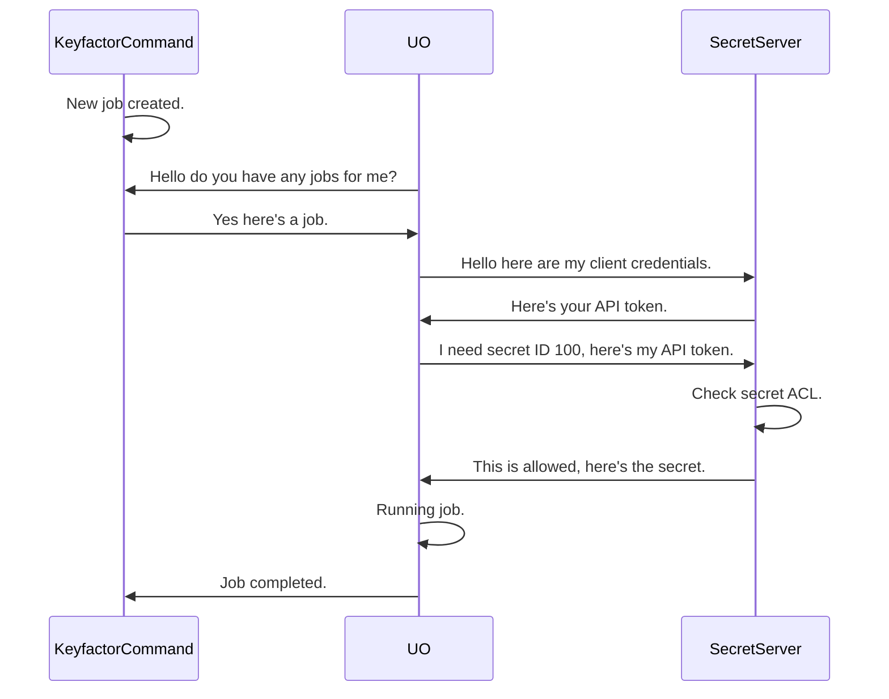
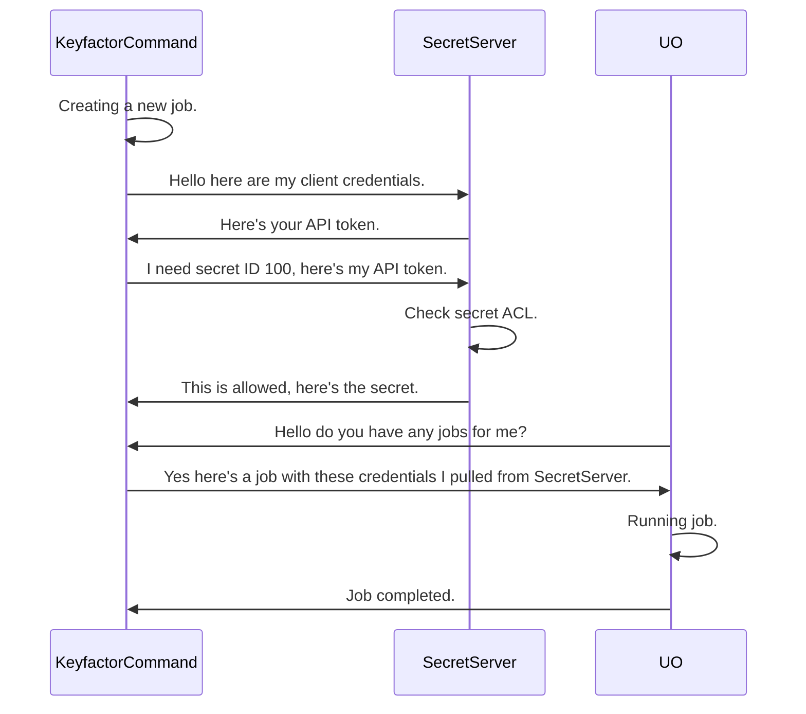

## Overview

The Delinea Secret Server PAM Provider allows for the retrieval of stored account credentials from a Delinea Secret
Server secret. Three authentication methods are supported: `password` (username/password), `client_credentials`
(OAuth2 application account), and `windows` (Integrated Windows Authentication).

## Extension Mechanics

When configuring the Delinea Secret Server for use as a PAM Provider with Keyfactor, you will need to ensure that your
instance is configured for API access. This can be done by logging into the Delinea Secret Server as an administrator.
For more details visit the vendor docs [here](https://docs.delinea.com/online-help/secret-server/api-scripting/sdk-devops/using-sdk/index.htm#SetupProcedure).

Once API access is configured, an account with credentials for the chosen grant type is required (username and password,
client ID and client secret, or the Windows identity of the running process). That account *MUST* be granted access
to view the secrets you'll be using.

After adding and sharing a secret on SecretServer, you can use the secret's ID (the "Secret ID") and the desired value's
field name (the "Secret Field Name") to retrieve credentials from the Delinea Secret Server as a PAM Provider.

### Running the PAM provider on Keyfactor Universal Orchestrator (UO)
When installing on the Universal Orchestrator (UO), is installed on and run from the UO host. Below is a sequence diagram
showing the flow of the PAM provider when it is run from the UO.



### Running the PAM provider on the Keyfactor Command Host
When installing the PAM provider on the Keyfactor Command Host, is installed on and run from the Keyfactor Command host.
Below is a sequence diagram showing the flow of the PAM provider when it is run from the Keyfactor Command Host.



## PAM Types

This provider ships four PAM types. For new installations, use the type-specific variants — they only expose the
fields relevant to the chosen authentication flow, which simplifies configuration in the Keyfactor Command UI.

| PAM Type | Auth Method | Server Parameters |
| --- | --- | --- |
| `Delinea-SecretServer-Password` | Username + Password | `Host`, `Username`, `Password` |
| `Delinea-SecretServer-ClientCredentials` | OAuth2 Client Credentials | `Host`, `ClientId`, `ClientSecret` |
| `Delinea-SecretServer-Windows` | Integrated Windows Authentication | `Host` |
| `Delinea-SecretServer` | Any (selected via `GrantType`) | `Host`, plus credentials for the chosen grant type |

> [!NOTE]
> `Delinea-SecretServer` is the original backwards-compatible type retained for existing installations. It requires
> a `GrantType` field and exposes all credential fields in the Keyfactor Command UI regardless of which grant type
> is active. Existing installations do not need to change.

## Dummy Values

When using the backwards-compatible `Delinea-SecretServer` type, the Keyfactor Command UI requires all declared
fields to be populated. For fields that are not applicable to the chosen authentication flow, enter `N/A` as the
value. The provider treats `N/A` (case-insensitive) as equivalent to an empty value and will not attempt to use it.

> [!TIP]
> For new installations, use the type-specific PAM types (`Delinea-SecretServer-Password`,
> `Delinea-SecretServer-ClientCredentials`, `Delinea-SecretServer-Windows`) to avoid this entirely — they only
> expose the fields relevant to the chosen authentication flow.

## Registration and Naming

> [!IMPORTANT]
> A Universal Orchestrator supports only **one** PAM provider registration per `manifest.json` (until UO v26.4).
> Using more than one Delinea PAM type requires a separate Universal Orchestrator for each.

The release contains one manifest file per PAM type. `manifest.json` registers the generic `Delinea-SecretServer`
provider. To use a type-specific provider, replace `manifest.json` with that type's manifest file (rename it to
`manifest.json` on install) and edit it.

| PAM Type / Name | Manifest shipped in the release | Class (`TypeFullName` / `web.config` `mapTo`) |
| --- | --- | --- |
| `Delinea-SecretServer` | `manifest.json` (default) | `Keyfactor.Extensions.Pam.Delinea.SecretServerPam` |
| `Delinea-SecretServer-Password` | `Password-manifest.json` | `Keyfactor.Extensions.Pam.Delinea.SecretServerPamPassword` |
| `Delinea-SecretServer-ClientCredentials` | `ClientCredentials-manifest.json` | `Keyfactor.Extensions.Pam.Delinea.SecretServerPamClientCredentials` |
| `Delinea-SecretServer-Windows` | `Windows-manifest.json` | `Keyfactor.Extensions.Pam.Delinea.SecretServerPamWindows` |

Each manifest registers its extension under the name of the **PAM provider you created in Keyfactor Command** (the
provider instance name, not the PAM type name): the extension entry key is that name itself, with no `PAMProviders.`
prefix and no `.PAMProvider` suffix, and the `InitializationInfo` section is named
`Keyfactor:PAMProviders:<provider name>:InitializationInfo`. The shipped placeholder is `YOUR-PROVIDER-NAME`; replace
it in both places before use. Each manifest contains only this one section; no section named after the PAM type is
needed. Any provider name works as long as the extension key and the section name match the provider name in Command. An unedited manifest does not register a usable provider.

The type-specific classes use a fixed grant type (`password`, `client_credentials`, `windows`), so no `GrantType`
value is required for them. For Command-hosted (Command 10) `web.config` registrations, use the class above with the
assembly name `delinea-secretserver-pam`, for example:
`mapTo="Keyfactor.Extensions.Pam.Delinea.SecretServerPamClientCredentials, delinea-secretserver-pam"`.

> [!NOTE]
> Each PAM type defines exact `manifest.json` and `web.config` snippets for that type,
> and the manifest files are shipped in the release.

> [!WARNING]
> **Upgrading from 1.3.0:** the shipped manifests changed key shape (see the
> changelog). Installing 1.3.1 over an edited `manifest.json` overwrites your edits, and an unedited 1.3.1 manifest
> is not usable until `YOUR-PROVIDER-NAME` is replaced with your PAM provider name. If you use a type-specific
> provider, install its manifest file as `manifest.json`, and remove any `GrantType` workaround you added.

## Installing the extension

These steps apply to every PAM type; each type's install section below only adds the manifest file to use and its
`InitializationInfo` values.

### Step 1: Install the assemblies

* **Using kfutil**: On the server that hosts the Universal Orchestrator, run the following command:

    ```shell
    # Windows Server
    kfutil orchestrator extension -e delinea-secretserver-pam@latest --out "C:\Program Files\Keyfactor\Keyfactor Orchestrator\extensions"

    # Linux
    kfutil orchestrator extension -e delinea-secretserver-pam@latest --out "/opt/keyfactor/orchestrator/extensions"
    ```

* **Manually**: Download the latest release of the Delinea Secret Server PAM Provider from the [Releases](../../releases) page. Extract the contents of the archive to:

    * **Windows Server**: `C:\Program Files\Keyfactor\Keyfactor Orchestrator\extensions\delinea-secretserver-pam`
    * **Linux**: `/opt/keyfactor/orchestrator/extensions/delinea-secretserver-pam`

### Step 2: Select the manifest for your PAM type

Use the manifest file for your PAM type from the table in [Registration and Naming](#registration-and-naming). Only
`Delinea-SecretServer` uses `manifest.json` as shipped; for the type-specific types, replace the contents of
`manifest.json` with the contents of that type's manifest file (for example, delete `manifest.json` and rename
`Password-manifest.json` to `manifest.json`).

### Step 3: Edit `manifest.json`

* Replace `YOUR-PROVIDER-NAME` (the extension entry key and the `InitializationInfo` section name) with the name of the PAM provider you created in Keyfactor Command for your PAM type, that is, the name you gave the provider instance, not the PAM type name. The `extensions` entry key is that name itself, with no `PAMProviders.` prefix and no `.PAMProvider` suffix, and the configuration section uses the same name: `Keyfactor:PAMProviders:<provider name>:InitializationInfo`. For example, for a provider named `Delinea`, the `extensions` entry key is `"Delinea": { ... }` and the section is `"Keyfactor:PAMProviders:Delinea:InitializationInfo": { ... }`.
* Replace the placeholder values in the section with the values collected in the Requirements section of your PAM type's page:
  [`Delinea-SecretServer`](docs/delinea-secretserver.md#requirements),
  [`Delinea-SecretServer-Password`](docs/delinea-secretserver-password.md#requirements),
  [`Delinea-SecretServer-ClientCredentials`](docs/delinea-secretserver-clientcredentials.md#requirements), or
  [`Delinea-SecretServer-Windows`](docs/delinea-secretserver-windows.md#requirements).
* Do not leave any other `Keyfactor:PAMProviders:*:InitializationInfo` sections in `manifest.json` (for example, sections left over from the 1.3.0 manifest). In testing, sample sections left in `manifest.json` supplied their placeholder values to the plugin in place of the real ones.

> [!IMPORTANT]
> Update placeholder values `YOUR-PROVIDER-NAME`. This needs to match the name of the provider instance defined in
> Keyfactor Command, if it does not you may encounter failed with `No extension configuration found
> for 'Keyfactor.Platform.Extensions.IPAMProvider' with name '<provider name>'` followed by `No PAM provider registered
> with name <provider name>`.

### Step 4: Restart

Restart the Universal Orchestrator service after editing `manifest.json`.
