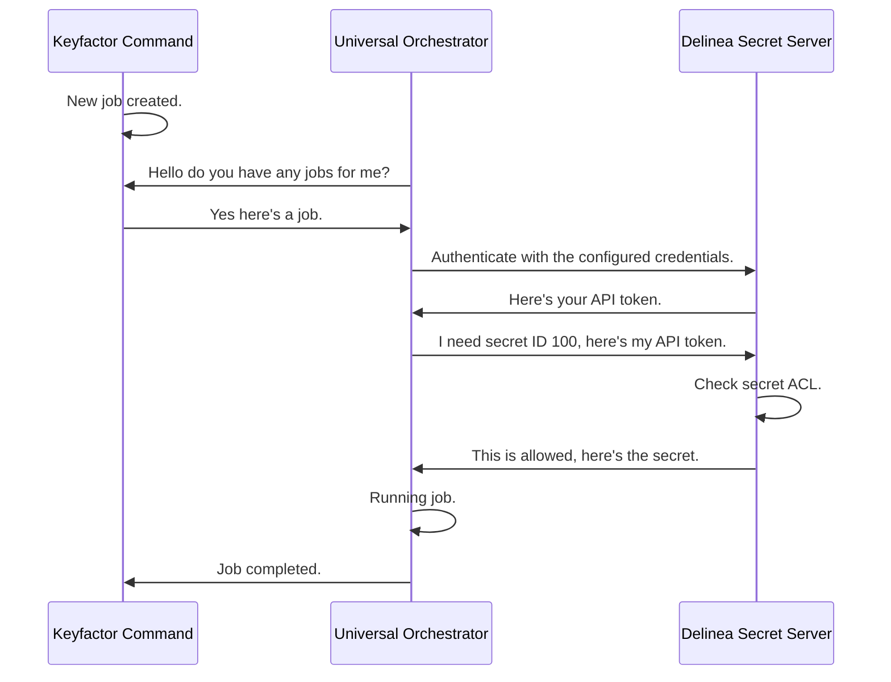
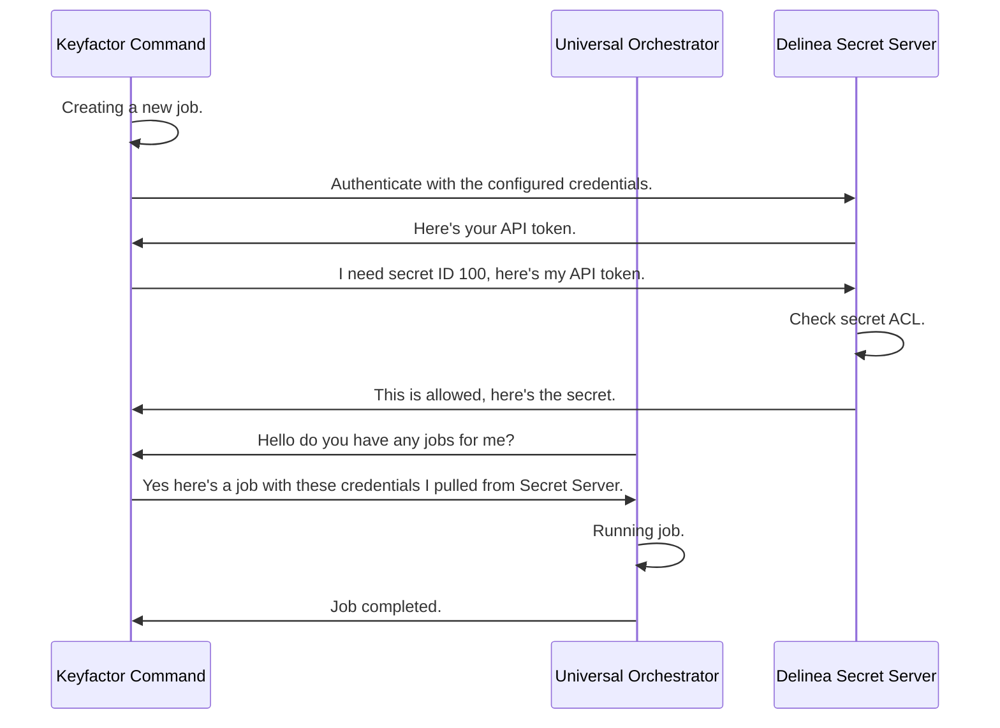

## Overview

The Delinea Secret Server PAM Provider allows for the retrieval of stored account credentials from a Delinea Secret
Server secret. Three authentication methods are supported: `password` (username/password), `client_credentials`
(OAuth2 application account), and `windows` (Integrated Windows Authentication).

Terminology used in this document:

* **PAM provider** is this extension (the assemblies installed on the Keyfactor Command host or the Universal Orchestrator).
* **PAM type** is the definition created in Keyfactor Command that declares which parameters the provider takes.
* **Provider instance** is a PAM provider you define in Keyfactor Command from a PAM type, with a name and the server-level values.

## Extension Mechanics

When configuring the Delinea Secret Server for use as a PAM Provider with Keyfactor, you will need to ensure that your
instance is configured for API access. This can be done by logging into the Delinea Secret Server as an administrator.
For more details visit the vendor docs [here](https://docs.delinea.com/online-help/secret-server/api-scripting/sdk-devops/using-sdk/index.htm#SetupProcedure).

Once API access is configured, an account with credentials for the chosen grant type is required (username and password,
client ID and client secret, or the Windows identity of the running process). That account *MUST* be granted access
to view the secrets you'll be using.

After adding and sharing a secret in Secret Server, you can use the secret's ID (the "Secret ID") and the desired value's
field name (the "Secret Field Name") to retrieve credentials from the Delinea Secret Server as a PAM Provider.

For the `password` and `client_credentials` grant types, the provider first requests an access token from the Secret
Server `/oauth2/token` endpoint, then uses that token to read the secret. For `client_credentials`, the token request
is still sent with `grant_type=password`: the Client ID is sent as `username` and the Client Secret as `password`.
For the `windows` grant type there is no token step; the provider calls the Secret Server `winauthwebservices` endpoint
directly using the Windows identity of the running process.

### Running the PAM provider on a Keyfactor Universal Orchestrator (UO)

When installed on a Universal Orchestrator (UO), the PAM provider runs on the UO host. The sequence diagram below
shows the flow when the provider runs from the UO.



### Running the PAM provider on the Keyfactor Command Host

When installed on the Keyfactor Command host, the PAM provider runs on that host. The sequence diagram below shows
the flow when the provider runs from the Keyfactor Command host.



> [!NOTE]
> The authentication and token steps in both diagrams apply to the `password` and `client_credentials` grant types. With
> the `windows` grant type there is no token: the provider calls Secret Server using the Windows identity of the
> running process.

## PAM Types

This provider ships four PAM types. For new installations, use the type-specific variants. They only expose the
fields relevant to the chosen authentication flow, which simplifies configuration in the Keyfactor Command UI.

| PAM Type | Auth Method | Server Parameters |
| --- | --- | --- |
| `Delinea-SecretServer-Password` | Username + Password | `Host`, `Username`, `Password` |
| `Delinea-SecretServer-ClientCredentials` | OAuth2 Client Credentials | `Host`, `ClientId`, `ClientSecret` |
| `Delinea-SecretServer-Windows` | Integrated Windows Authentication | `Host` |
| `Delinea-SecretServer` | Any (selected via `GrantType`) | `Host`, plus credentials for the chosen grant type, `GrantType` (optional) |

> [!NOTE]
> `Delinea-SecretServer` is the original backwards-compatible type retained for existing installations. It exposes all
> credential fields in the Keyfactor Command UI regardless of which grant type is active. `GrantType` is optional and
> defaults to `password` when it is not supplied. Existing installations do not need to change.

> [!IMPORTANT]
> `Delinea-SecretServer-Windows` uses Integrated Windows Authentication, which is not supported on Delinea Secret
> Server Cloud. It is only compatible with on-premises Secret Server installations.

## Configuration Notes

* **`SecretFieldName`** is matched against each field's name or slug on the secret. The comparison is case-sensitive
  and must be exact. An empty value is an error, and so is a field that does not exist on the secret.
* **`GrantType`** (generic `Delinea-SecretServer` type only) is case-sensitive and must be exactly `password`,
  `client_credentials` or `windows`. The shipped placeholder `password|client_credentials|windows` must be replaced
  with one of these values.
* **Dummy values.** The `N/A` convention for unused fields applies to the generic `Delinea-SecretServer` type; see its
  [Requirements](docs/delinea-secretserver.md#requirements).

## Registration and Naming

> [!IMPORTANT]
> A Universal Orchestrator supports only **one** PAM provider registration per `manifest.json` (until UO v26.4).
> Using more than one Delinea PAM type requires a separate Universal Orchestrator for each.

The release contains one manifest file per PAM type. `manifest.json` registers the generic `Delinea-SecretServer`
provider. To use a type-specific provider, replace `manifest.json` with that type's manifest file (rename it to
`manifest.json` on install) and edit it.

| PAM Type / Name | Manifest shipped in the release | Class (`TypeFullName` / `web.config` `mapTo`) |
| --- | --- | --- |
| `Delinea-SecretServer` | `manifest.json` (default) | `Keyfactor.Extensions.Pam.Delinea.SecretServerPam` |
| `Delinea-SecretServer-Password` | `Password-manifest.json` | `Keyfactor.Extensions.Pam.Delinea.SecretServerPamPassword` |
| `Delinea-SecretServer-ClientCredentials` | `ClientCredentials-manifest.json` | `Keyfactor.Extensions.Pam.Delinea.SecretServerPamClientCredentials` |
| `Delinea-SecretServer-Windows` | `Windows-manifest.json` | `Keyfactor.Extensions.Pam.Delinea.SecretServerPamWindows` |

Each manifest registers its extension under the name of the **PAM provider you created in Keyfactor Command** (the
provider instance name, not the PAM type name). The extension entry key is that name itself, with no `PAMProviders.`
prefix and no `.PAMProvider` suffix, and the `InitializationInfo` section is named
`Keyfactor:PAMProviders:<provider name>:InitializationInfo`. The shipped placeholder is `YOUR-PROVIDER-NAME`; replace
it in both places before use. Each manifest contains only this one section. An unedited manifest does not register a
usable provider.

The type-specific classes use a fixed grant type (`password`, `client_credentials`, `windows`), so no `GrantType`
value is required for them. For Command-hosted (Command 10) `web.config` registrations, use the class above with the
assembly name `delinea-secretserver-pam`, for example:
`mapTo="Keyfactor.Extensions.Pam.Delinea.SecretServerPamClientCredentials, delinea-secretserver-pam"`.

> [!NOTE]
> Each PAM type defines exact `manifest.json` and `web.config` snippets for that type,
> and the manifest files are shipped in the release.

> [!WARNING]
> **Upgrading from 1.3.0:** the shipped manifests changed key shape (see the
> changelog). Installing 1.3.1 over an edited `manifest.json` overwrites your edits, and an unedited 1.3.1 manifest
> is not usable until `YOUR-PROVIDER-NAME` is replaced with your PAM provider name. If you use a type-specific
> provider, install its manifest file as `manifest.json`, and remove any `GrantType` workaround you added.

## Installing on a Universal Orchestrator

> [!NOTE]
> Before installing on a Universal Orchestrator, the PAM type and a provider instance must already exist in Keyfactor
> Command. See *Create PAM type in Keyfactor Command* and *Define a remote PAM provider in Command* in the sections for your PAM type below.

These steps apply to every PAM type; each type's install section below only adds the manifest file to use and its
`InitializationInfo` values.

### Step 1: Install the assemblies

* **Using kfutil**: On the server that hosts the Universal Orchestrator, run the following command:

    ```shell
    # Windows Server
    kfutil orchestrator extension -e delinea-secretserver-pam@latest --out "C:\Program Files\Keyfactor\Keyfactor Orchestrator\extensions"

    # Linux
    kfutil orchestrator extension -e delinea-secretserver-pam@latest --out "/opt/keyfactor/orchestrator/extensions"
    ```

* **Manually**: Download the latest release of the Delinea Secret Server PAM Provider from the [Releases](../../releases) page. Extract the contents of the archive to:

    * **Windows Server**: `C:\Program Files\Keyfactor\Keyfactor Orchestrator\extensions\delinea-secretserver-pam`
    * **Linux**: `/opt/keyfactor/orchestrator/extensions/delinea-secretserver-pam`

### Step 2: Select the manifest for your PAM type

Use the manifest file for your PAM type from the table in [Registration and Naming](#registration-and-naming). Only
`Delinea-SecretServer` uses `manifest.json` as shipped; for the type-specific types, replace the contents of
`manifest.json` with the contents of that type's manifest file (for example, delete `manifest.json` and rename
`Password-manifest.json` to `manifest.json`).

### Step 3: Edit `manifest.json`

* Replace `YOUR-PROVIDER-NAME` (the extension entry key and the `InitializationInfo` section name) with the name of the PAM provider you created in Keyfactor Command for your PAM type, that is, the name you gave the provider instance, not the PAM type name. For example, for a provider named `Delinea`, the `extensions` entry key is `"Delinea": { ... }` and the section is `"Keyfactor:PAMProviders:Delinea:InitializationInfo": { ... }`.
* Replace the placeholder values in the section with the values collected in the Requirements section of your PAM type's page:
  [`Delinea-SecretServer`](docs/delinea-secretserver.md#requirements),
  [`Delinea-SecretServer-Password`](docs/delinea-secretserver-password.md#requirements),
  [`Delinea-SecretServer-ClientCredentials`](docs/delinea-secretserver-clientcredentials.md#requirements), or
  [`Delinea-SecretServer-Windows`](docs/delinea-secretserver-windows.md#requirements).
* Do not leave any other `Keyfactor:PAMProviders:*:InitializationInfo` sections in `manifest.json` (for example, sections left over from the 1.3.0 manifest). In testing, sample sections left in `manifest.json` supplied their placeholder values to the plugin in place of the real ones.

> [!IMPORTANT]
> Replace the placeholder `YOUR-PROVIDER-NAME`. It must match the name of the provider instance defined in
> Keyfactor Command. If it does not, the provider may fail to load, with errors such as `No extension configuration found
> for 'Keyfactor.Platform.Extensions.IPAMProvider' with name '<provider name>'` followed by `No PAM provider registered
> with name <provider name>`.

### Step 4: Restart

Restart the Universal Orchestrator service after editing `manifest.json`.

## Troubleshooting

* **Provider not found / not registered on a UO.** Confirm that the `extensions` entry key and the
  `InitializationInfo` section name in `manifest.json` both equal the name of the provider instance in Keyfactor
  Command (not `YOUR-PROVIDER-NAME`), that only one provider is registered in the file, and that the UO service was
  restarted.
* **`Invalid grant type ... specified`.** `GrantType` must be exactly `password`, `client_credentials` or `windows`
  (case-sensitive).
* **`... not provided`.** A required server or instance parameter is missing or empty. Parameters whose value is `N/A`
  are treated as empty.
* **`Unable to parse '<value>' as an integer`.** `SecretId` must be the numeric Secret ID, not the secret's name.
* **`Field '<name>' not found in secret <id>`.** `SecretFieldName` must equal a field name or slug on the secret
  (case-sensitive).
* **Authentication failure.** Check the credentials for the chosen grant type and that the account can view the secret.
  The provider logs the failing step, HTTP status code and the target URL.
* **TLS errors.** Install the Secret Server CA certificate on the host. As a temporary measure in non-production
  environments only, see TLS validation under [Configuration Notes](#configuration-notes).

## Security Considerations

* The values in `manifest.json` `InitializationInfo` (for example `Password`, `ClientSecret`) are stored in plaintext on
  the Universal Orchestrator host. Restrict file-system permissions on the `manifest.json` file to the account that runs
  the orchestrator service and to administrators.
* Grant the Secret Server account used by the provider access only to the secrets it needs.

## Upgrade Notes

See the [CHANGELOG](CHANGELOG.md) for the full release history. In particular, the v1.3.1 sections *Breaking Changes*
and *Upgrade Notes* describe the new `manifest.json` key shape, why an unedited manifest is not usable, and that
installing over an edited `manifest.json` overwrites it.
